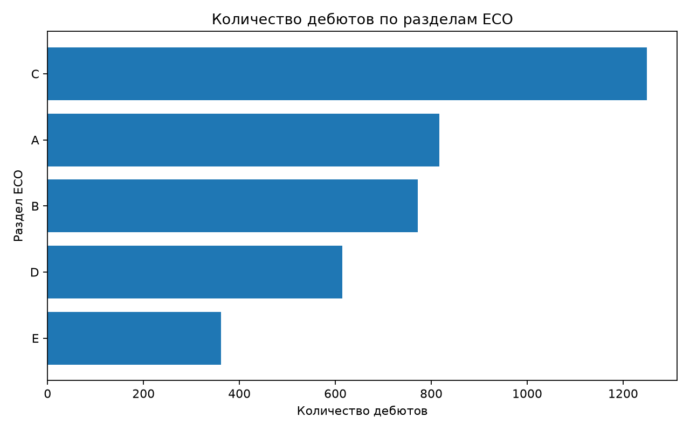
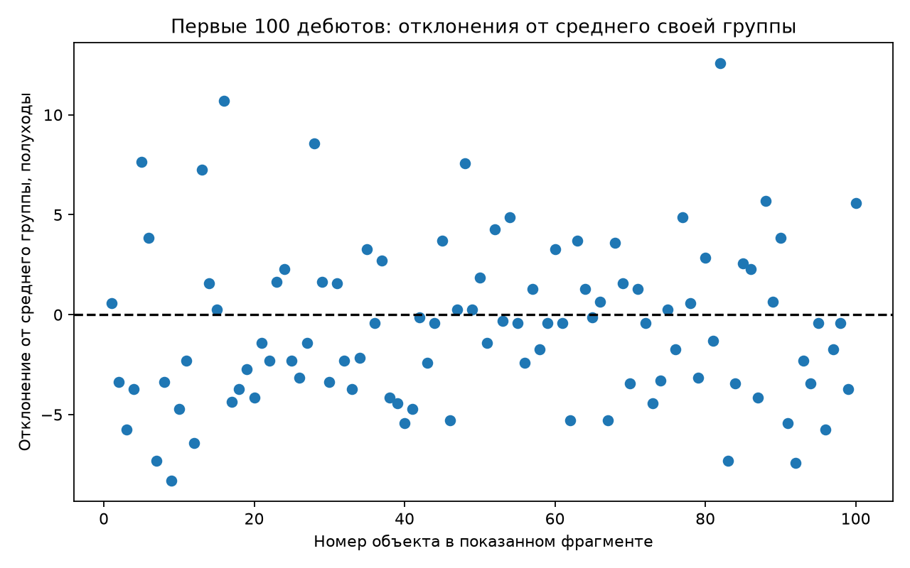
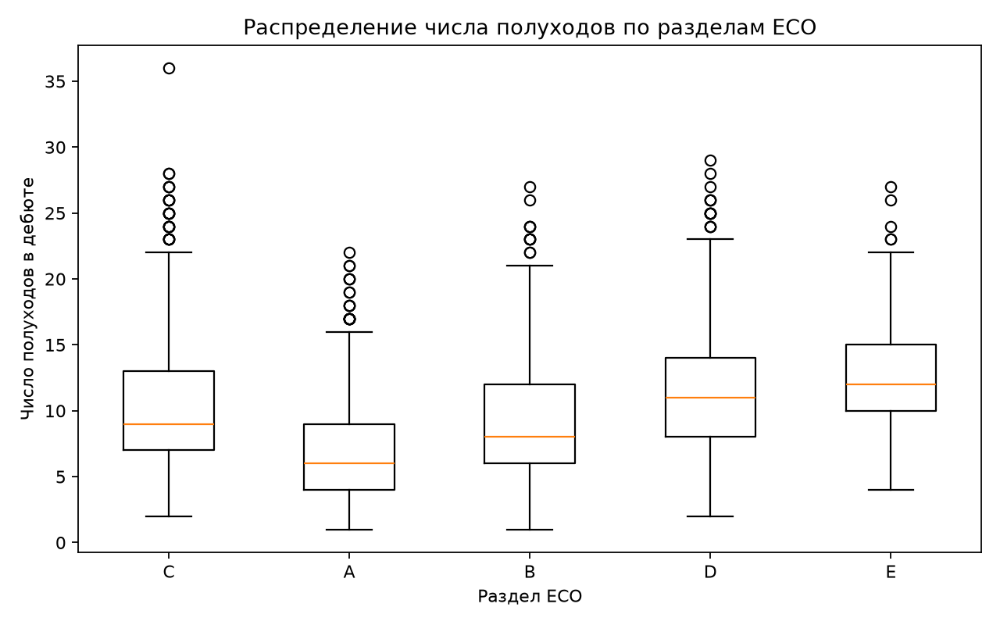

# Лабораторная № 2. NumPy и pandas

Возьмите датасет из первой лабораторной работы по варианту из второй. Сделайте один блокнот с кодом, результатами, графиками и краткими пояснениями.

## Варианты

**X** — столбец с числами, которые будем изучать. По **G** будем делить строки на группы. Например, у аэропортов X — высота, а G — тип аэропорта.

| Датасет | X | G |
| --- | --- | --- |
| [Книги](https://github.com/itmo-python-programming/course/blob/main/lab1/data/books/records.json) | editions — число изданий | десятилетие по year |
| [Искусство](https://github.com/itmo-python-programming/course/blob/main/lab1/data/artworks/records.csv) | width_mm — ширина, мм | десятилетие по acquired |
| [Аэропорты](https://github.com/itmo-python-programming/course/blob/main/lab1/data/airports/records.csv) | elevation_ft — высота, футы | kind — тип аэропорта |
| [Землетрясения](https://github.com/itmo-python-programming/course/blob/main/lab1/data/earthquakes/records.jsonl) | magnitude — магнитуда | network — сеть наблюдений |
| [Шахматные дебюты](https://github.com/itmo-python-programming/course/blob/main/lab1/data/chess/records.json) | plies — число полуходов | eco_volume — раздел ECO |
| [Экзопланеты](https://github.com/itmo-python-programming/course/blob/main/lab1/data/exoplanets/records.csv) | radius_earth — радиус в радиусах Земли | method — метод обнаружения |
| [Статьи](https://github.com/itmo-python-programming/course/blob/main/lab1/data/papers/records.jsonl) | citations — число цитирований | field — научная область |

Для десятилетий объедините, например, годы 2010–2019 в группу 2010.

Для заданий 3 и 4 сделайте отдельные копии таблицы, чтобы не менять данные для остальных заданий. При расчёте среднего и других характеристик не учитывайте пропуски. Строки без значения G соберите в группу "Неизвестно".

## 1. Подготовка

Самостоятельно установите и запустите **JupyterLab — выполнять работу обязательно в нём**. Создайте блокнот, разберитесь с ячейками кода и Markdown, запуском ячеек и перезапуском ядра.

В начале блокнота создайте генератор случайных чисел:

```python
import numpy as np

SEED = 42
rng = np.random.default_rng(SEED)
```

Для случайного выбора в NumPy используйте этот rng, например rng.choice. В pandas передавайте тот же seed: например, df.sample(frac=0.1, random_state=SEED) выберет случайные 10% строк.

Seed задаёт начальное состояние генератора. При одинаковых данных и порядке команд повторный запуск всего блокнота выберет те же строки. Другой seed обычно даст другой выбор. Само число 42 ничем не особенное.

## 2. Загрузка

Скачайте данные, загрузите их в pandas и выведите первые пять записей. Если хотите загружать данные из CSV, разрешено сначала в том же блокноте преобразовать JSON или JSONL в CSV.

Убедитесь, что в X находятся числа: например, число 12, а не строка "12". Пустая ячейка должна считаться пропуском, а не нулём или текстом "null". Если в вашем варианте нужны десятилетия, создайте для них отдельный столбец G.

## 3. Пропуски

Выберите случайные 10% строк, где X заполнен. Сохраните их номера и значения X, затем замените эти значения пропусками.

На трёх копиях полученной таблицы заполните одни и те же пропуски: средним по X, медианой по X и способом на свой выбор. Среднее, медиану и другие значения для заполнения считайте после удаления. Сохранённые значения используйте только для проверки.

Для каждого способа посчитайте MAE и MSE только на удалённых значениях. MAE — среднее абсолютных ошибок, MSE — среднее квадратов ошибок. Например, если было 10, а восстановили 12, абсолютная ошибка равна 2, её квадрат — 4. Используйте функции NumPy и pandas. Сравните результаты и объясните, какой способ лучше по каждой метрике и почему метрики дают разные числа.

## 4. Дубликаты

Выберите случайные 5% строк и добавьте их точные копии в таблицу. На трёх независимых копиях полученной таблицы удалите повторы:

1. По совпадению всех столбцов.
2. По совпадению id.
3. По совпадению любого другого поля на ваш выбор.

Сравните количество строк и среднее X до добавления копий, после добавления и после каждого способа удаления.

Для третьего способа покажите строки с одинаковым значением выбранного поля, но разными id, или укажите, что таких строк нет.

## 5. Числовые характеристики

Посчитайте размах, среднее, медиану, дисперсию и стандартное отклонение X своим кодом, без готовых функций для этих характеристик. Циклы, сортировка и обычная арифметика разрешены.

- Размах — максимум минус минимум.
- Среднее — сумма значений, делённая на их количество.
- Медиана — центральное значение после сортировки. Если значений чётное количество, возьмите среднее двух центральных.
- Дисперсия — вычтите среднее из каждого значения, возведите разности в квадрат и найдите среднее полученных квадратов.
- Стандартное отклонение — квадратный корень из дисперсии.

Сравните результаты с функциями NumPy и pandas (mean, median, var, std и т. д.).

## 6. Фильтрация

Выберите две группы G и число, с которым будете сравнивать X. Например, для аэропортов — два типа аэропорта и высоту 500 футов. Выберите границу так, чтобы часть значений X была выше, а часть — не выше.

Получите две таблицы:

- строки из выбранных групп, у которых X выше границы;
- строки из выбранных групп **или** с X выше границы — достаточно любого из условий.

Сравните количество строк. Покажите строки, которые есть только во второй таблице. Отсутствующее значение X не считайте значением выше границы.

## 7. Порядок операций

Возьмите первое условие из задания 6 и сравните два порядка:

- сначала отберите подходящие строки, затем оставьте пять с наибольшими X;
- сначала возьмите пять наибольших X из всей таблицы, затем отберите подходящие строки.

Покажите обе таблицы и объясните, почему результаты совпали или различаются. Всегда ли они будут одинаковыми?

## 8. Группировка

Для каждой группы G посчитайте количество строк, долю от всей таблицы, число пропусков X, среднее и медиану X.

Постройте горизонтальную столбчатую диаграмму количества объектов: самая большая группа сверху, самая маленькая снизу. Подпишите оси. Опишите, каких групп много, а каких мало.



## 9. Объект и его группа

Добавьте к каждой исходной строке **group_count** — количество строк в её группе и **group_mean** — среднее X этой группы из задания 8. Проверьте, что количество строк осталось прежним.

Добавьте **delta**: из X строки вычтите group_mean. Покажите DataFrame с новыми колонками.

**а)** Возьмите первые 100 строк с заполненным X (или все, если их меньше). Постройте график с точками: по горизонтали — порядковый номер объекта в выбранном фрагменте, по вертикали — delta. Проведите горизонтальную линию на нуле. Точка выше линии означает, что X объекта больше среднего его группы, ниже — меньше.



**б)** Отсортируйте те же строки по возрастанию delta и постройте линейный график. По горизонтали расположите новые порядковые номера от 1 до количества выбранных строк на равных расстояниях, по вертикали — delta. Соедините соседние точки линией: она должна идти слева направо без убывания. Подпишите оси.

## 10. Квантили и boxplot

Посчитайте квантили X уровней 0,25; 0,5; 0,75. Квантиль 0,5 — медиана, а 0,25 и 0,75 показывают границы центральной половины значений.

Выберите пять групп с наибольшим количеством строк и постройте для них boxplot на одном графике. Подпишите оси. В каких группах медиана выше? В каких значения сильнее разбросаны?



Иллюстрации показывают шахматный датасет. Для построения графиков используйте библиотеку Matplotlib. Чтобы определить нужный тип графика по примеру, ознакомьтесь с [видами графиков с иллюстрациями в документации](https://matplotlib.org/stable/plot_types/index.html).
