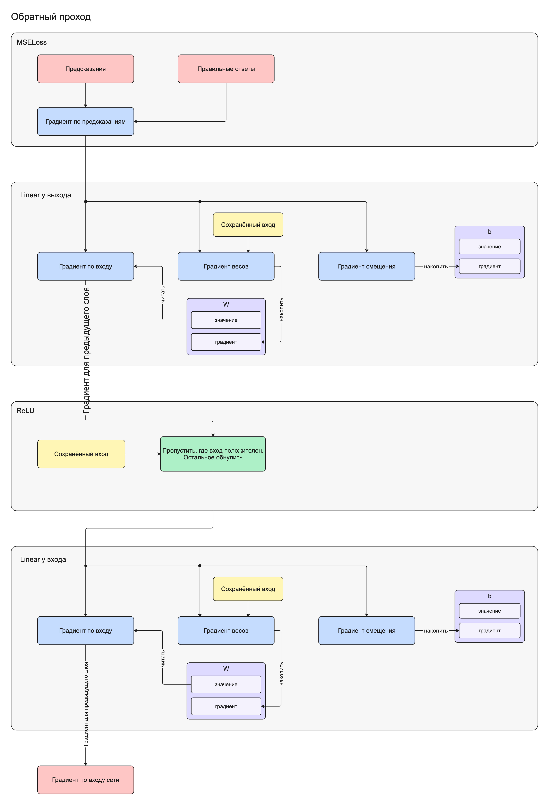

# Лабораторная работа № 3. Свой небольшой PyTorch

## 0. Введение

В машинном обучении вы будете регулярно пользоваться фреймворками: собирать модели из готовых компонентов, обучать их и сохранять результаты. Один из таких инструментов — PyTorch. В этой работе вы создадите собственную небольшую библиотеку с похожими возможностями.

Основная задача — научиться проектировать классы, распределять ответственность между ними и организовывать взаимодействие объектов.

## 1. Подготовка

Реализуйте библиотеку на Python. **Обязательно разделите код на модули.** Примеры использования оформите отдельно — в скрипте или блокноте.

Для вычислений используйте NumPy. Использовать PyTorch и другие готовые библиотеки нейронных сетей для реализации компонентов нельзя.

Входные данные представляйте двумерными массивами: строки соответствуют объектам, столбцы — их признакам.

Набросайте первоначальную **UML-диаграмму классов**: какие классы могут понадобиться и как они связаны. Изменяйте диаграмму по мере работы над библиотекой.

## 2. Базовый класс слоя и линейное преобразование

**Слой** — объект, который принимает массив, выполняет преобразование и возвращает результат.

Некоторые слои содержат **обучаемые параметры** — числа, от которых зависит результат преобразования. Во время обучения модель изменяет именно эти параметры.

Создайте абстрактный базовый класс `Layer` с методом `forward(x)`. Предусмотрите возможность вызывать слой как функцию: `layer(x)`.

На основе базового класса реализуйте слой `Linear`, выполняющий преобразование:

$$
Y=XW+b,
$$

где $X$ — входные данные, $W$ — веса, $b$ — смещение, $Y$ — результат. Веса и смещение являются обучаемыми параметрами.

Все обучаемые параметры инициализируйте небольшими случайными числами около нуля.

Пользователь должен иметь возможность написать:

```python
x = np.array([
    [1.0, 2.0],
    [-1.0, 3.0],
])

layer = Linear(2, 1)
result = layer(x)
```

Здесь слой принимает два признака и вычисляет одно выходное значение для каждого объекта. Результат содержит две строки и один столбец.

Следите за ограничениями матричного умножения и обрабатывайте несовместимые размеры.

## 3. Нелинейное преобразование

Реализуйте слой `ReLU`, наследующий `Layer`:

$$
Y_{ij}=\max(0,X_{ij}).
$$

Он заменяет отрицательные значения нулями и сохраняет форму массива. Обучаемых параметров у этого слоя нет.

Пользователь должен иметь возможность последовательно применить разные слои:

```python
linear = Linear(2, 8)
activation = ReLU()

result = activation(linear(x))
```

У слоёв одинаковый способ вызова, хотя выполняемые преобразования различаются.

## 4. Последовательная модель

Реализуйте класс `Sequential`, который объединяет слои в последовательность. Результат одного слоя становится входом следующего.

`Sequential` должен наследовать `Layer`, чтобы составную модель можно было использовать так же, как отдельный слой.

Пользователь должен иметь возможность написать:

```python
model = Sequential(
    Linear(2, 8),
    ReLU(),
    Linear(8, 1),
)

prediction = model(x)
```

Как и в примере с `Linear(2, 1)`, модель получает два признака и возвращает одно значение для каждого объекта, но теперь использует больше обучаемых параметров.

Предусмотрите вложенные последовательности:

```python
features = Sequential(
    Linear(2, 8),
    ReLU(),
)

model = Sequential(
    features,
    Linear(8, 1),
)

prediction = model(x)
```

## 5. Обучаемые параметры

Для обучения необходимо получать параметры всей модели, независимо от количества и вложенности её слоёв.

Реализуйте класс `Parameter`, который хранит:

- `value` — массив NumPy со значениями параметра;
- `grad` — массив той же формы, первоначально заполненный нулями.

Один объект `Parameter` хранит целый массив: например, матрицу весов. Поле `grad` понадобится для обучения. Его вычисление добавим в пункте 7; пока достаточно предусмотреть это поле.

В `Linear` храните веса и смещение как два объекта `Parameter`. При вычислении результата используйте их значения из `value`.

Добавьте в базовый класс `Layer` метод `parameters()` и обеспечьте следующее поведение:

- `Linear` возвращает список из двух объектов `Parameter`: веса и смещение;
- `ReLU` возвращает пустой список;
- `Sequential` возвращает единый плоский список параметров всех входящих слоёв, включая вложенные последовательности, в порядке их расположения.

Метод должен возвращать сами объекты параметров, а не их копии.

Пользователь должен иметь возможность получить параметры любой модели одинаковым способом:

```python
for parameter in model.parameters():
    print(parameter.value)
    print(parameter.grad)
```

## 6. Функция потерь

Теперь модель умеет получать результат. Необходимо сравнить его с правильным ответом и выразить величину ошибки одним числом. Для этого используется **функция потерь**.

Реализуйте класс `MSELoss`, вычисляющий среднюю квадратичную ошибку, с которой вы уже могли встречаться в предыдущей лабораторной работе:

$$
L=
\frac{1}{n}
\sum_{i=1}^{n}
\left(
\frac{1}{k}
\sum_{j=1}^{k}
(\hat Y_{ij}-Y_{ij})^2
\right),
$$

где:

- $\hat Y$ — предсказания модели;
- $Y$ — правильные ответы;
- $n$ — количество объектов;
- $k$ — количество выходных значений для одного объекта.

Метод `forward(prediction, target)` должен возвращать число. Объект также должен поддерживать вызов как функция:

```python
criterion = MSELoss()

prediction = model(x)
loss = criterion(prediction, target)
```

Формы предсказаний и правильных ответов должны совпадать. Обрабатывайте нарушение этого требования.

## 7. Обратное распространение градиентов

- После прямого прохода и вычисления ошибки необходимо обновить все обучаемые параметры модели (процесс обучения).
- Для обновления вычисляют **градиент ошибки по параметрам**. Он показывает, как изменение каждого параметра влияет на ошибку, и указывает направление её наискорейшего роста.
- Параметры обновляют, прибавляя произведение **антиградиента** (градиента со знаком минус) и гиперпараметра **learning rate**, то есть скорости обучения.
- **Обратное распространение** идёт в порядке, обратном прямому проходу: от функции потерь через последний слой к первому.
- Каждый слой вычисляет градиенты своих обучаемых параметров, если они есть, и сохраняет их в соответствующих полях `grad`. Кроме того, он вычисляет градиент по своему входу и передаёт его предыдущему слою, чтобы тот мог продолжить вычисления.
- Подробно рассмотрите схему и реализуйте обратный проход по формулам ниже. Реализуйте метод `backward` для каждого слоя и функции потерь. Продумайте, откуда и как будут последовательно вызываться эти методы, чтобы градиент по входу одного слоя передавался предыдущему слою модели.



**Linear**

Здесь $X$ — сохранённый вход слоя, $W$ — значения весов, $G$ — градиент, полученный от предыдущего слоя в порядке обратного прохода.

Градиент по входу:

$$
G_X=GW^{\mathsf T}.
$$

Градиенты по параметрам:

$$
G_W=X^{\mathsf T}G,
\qquad
(G_b)_j=\sum_{i=1}^{n}G_{ij}.
$$

**ReLU**

Здесь $X$ — сохранённый вход слоя, $G$ — градиент, полученный от предыдущего слоя в порядке обратного прохода.

Градиент по входу:

$$
(G_X)_{ij}=
\begin{cases}
G_{ij}, & X_{ij}>0,\\
0, & X_{ij}\leq 0.
\end{cases}
$$

Градиентов по параметрам нет: слой не содержит обучаемых параметров.

**MSELoss**

Градиент по входным предсказаниям:

$$
G_{\text{prediction}}=\frac{2}{n}\cdot\frac{\hat Y-Y}{k}.
$$

Градиентов по параметрам нет: функция потерь не содержит обучаемых параметров.

## 8. Оптимизатор

Теперь у каждого обучаемого параметра есть значение и вычисленный градиент. Следующий шаг — изменить значение так, чтобы уменьшить ошибку.

Эту задачу выполняет отдельный объект — **оптимизатор**. Он работает с параметрами и не зависит от того, из каких слоёв собрана модель.

Реализуйте класс `SGD`, который получает список параметров и положительную скорость обучения `lr`.

Скорость обучения называется **гиперпараметром**. В рамках этой работы параметр — то, что изменяется при обучении, а гиперпараметр — настройка, которую выбирает пользователь.

В классе `SGD` предусмотрите два метода:

- `step()` — обновляет каждое значение параметра, вычитая произведение `lr` и соответствующего градиента;
- `zero_grad()` — обнуляет градиенты всех переданных параметров.

Градиенты в пункте 7 накапливаются. Поэтому перед обработкой новой порции данных их необходимо обнулять.

Пользователь должен иметь возможность выполнить один шаг обучения:

```python
optimizer = SGD(model.parameters(), lr=0.05)

optimizer.zero_grad()

prediction = model(x)
loss = criterion(prediction, target)

model.backward(criterion.backward())
optimizer.step()
```

## 9. Обучение модели на MNIST

Используйте свою библиотеку для распознавания рукописных цифр из датасета MNIST.

Каждый объект — изображение размером $28\times28$ пикселей. Правильный ответ — цифра от $0$ до $9$.

Для загрузки установите `scikit-learn` и воспользуйтесь [`fetch_openml`](https://scikit-learn.org/stable/modules/generated/sklearn.datasets.fetch_openml.html). В этой работе `scikit-learn` используется только для получения данных.

```python
import numpy as np
from sklearn.datasets import fetch_openml

x, labels = fetch_openml(
    "mnist_784",
    version=1,
    as_frame=False,
    return_X_y=True,
)

x = x.astype(np.float32) / 255.0
labels = labels.astype(int)

x_train = x[:60000]
x_test = x[60000:]

labels_train = labels[:60000]
labels_test = labels[60000:]

y_train = np.eye(10, dtype=np.float32)[labels_train]
```

В загруженном массиве каждое изображение уже представлено строкой из $784$ значений. Деление на $255$ приводит яркости пикселей к диапазону от $0$ до $1$.

Модель должна возвращать **десять значений для каждого изображения** — по одному для каждой цифры. Правильный ответ для обучения также представьте десятью значениями: единица на позиции нужной цифры и нули на остальных. Например, для цифры $3$:

$$
(0,\ 0,\ 0,\ 1,\ 0,\ 0,\ 0,\ 0,\ 0,\ 0).
$$

Это представление называется **one-hot**. В приведённом коде оно создаётся в `y_train`.

Реализуйте функцию `train`, которая получает модель, обучающие данные, функцию потерь, оптимизатор, количество эпох и размер порции данных — `batch_size`.

**Эпоха** — один полный проход по обучающим данным. В начале каждой эпохи перемешивайте объекты вместе с их ответами, затем обрабатывайте порциями. Для порции из $m$ изображений модель получает массив размера $m\times784$, а функция потерь — предсказания и ответы размера $m\times10$.

Для каждой порции выполните шаг обучения из пункта 8. Обрабатывайте и последнюю порцию, если она меньше `batch_size`. Возвращайте историю средней ошибки по эпохам с учётом количества объектов в порциях.

Пользователь должен иметь возможность написать:

```python
model = Sequential(
    Linear(784, 32),
    ReLU(),
    Linear(32, 10),
)

criterion = MSELoss()
optimizer = SGD(model.parameters(), lr=0.05)

history = train(
    model,
    x_train,
    y_train,
    criterion,
    optimizer,
    epochs=10,
    batch_size=128,
)

scores = model(x_test)
predicted_labels = np.argmax(scores, axis=1)

accuracy = np.mean(predicted_labels == labels_test)
print(accuracy)
```

Предсказанная цифра — индекс наибольшего выходного значения. Сами выходные значения не требуется интерпретировать как вероятности.

Сравните долю правильных ответов до и после обучения. Постройте график ошибки по эпохам и покажите несколько тестовых изображений с правильными и предсказанными цифрами.

Тестовые данные используйте только для оценки: параметры модели на них не обновляйте.

## 10. Сохранение модели

Сделайте так, чтобы модель можно было сохранить в файл и загрузить из файла, восстановив её структуру и обучаемые параметры.

Пользователь должен иметь возможность написать:

```python
model.save("model.npz")

restored = Sequential.load("model.npz")
prediction = restored(x_test)
```

После загрузки модель должна возвращать те же предсказания на тех же данных. Формат файла выберите самостоятельно.

## 11. Составьте отчёт

- Добавьте UML-диаграмму классов.
- Покажите, как ваша модель обучается.
- Покажите, что ваша модель делает предсказания.
- Добавьте подсчёт метрик и демонстрацию работы модели ([пример](images/prediction-example.jpg)).

## Рекомендуемые материалы

Дополнительно к объяснениям в лабораторной:

- [Neural Networks Illustrated, Part 1: How Does a Neural Network Work?](https://towardsdatascience.com/neural-networks-illustrated-part-1-how-does-a-neural-network-work-c3f92ce3b462/)
- [Jay Alammar — A Visual and Interactive Guide to the Basics of Neural Networks](https://jalammar.github.io/visual-interactive-guide-basics-neural-networks/)
- [3Blue1Brown — But what is a neural network? Часть 1](https://www.youtube.com/watch?v=aircAruvnKk)
- [3Blue1Brown — Gradient descent, how neural networks learn. Часть 2](https://www.youtube.com/watch?v=IHZwWFHWa-w)
